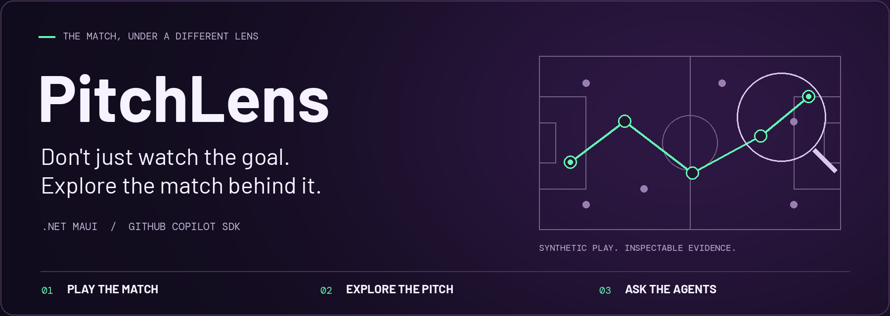
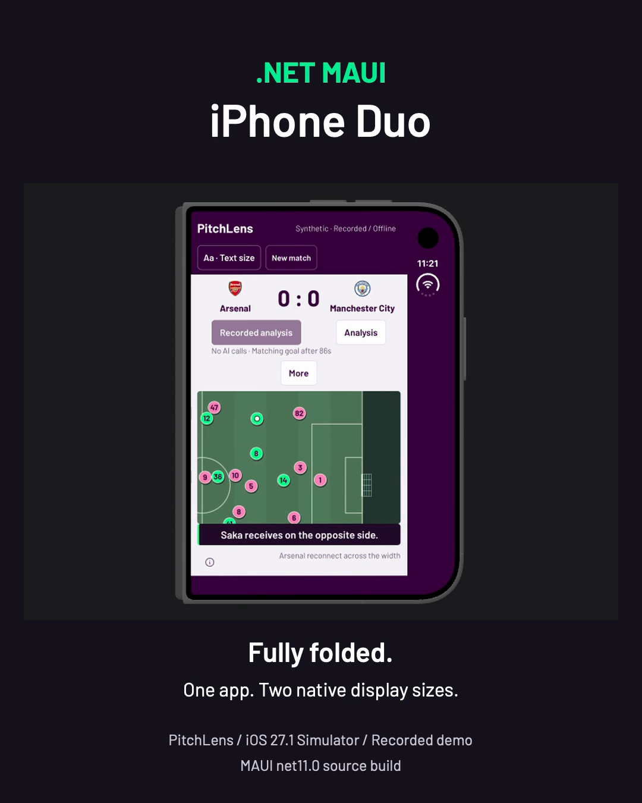
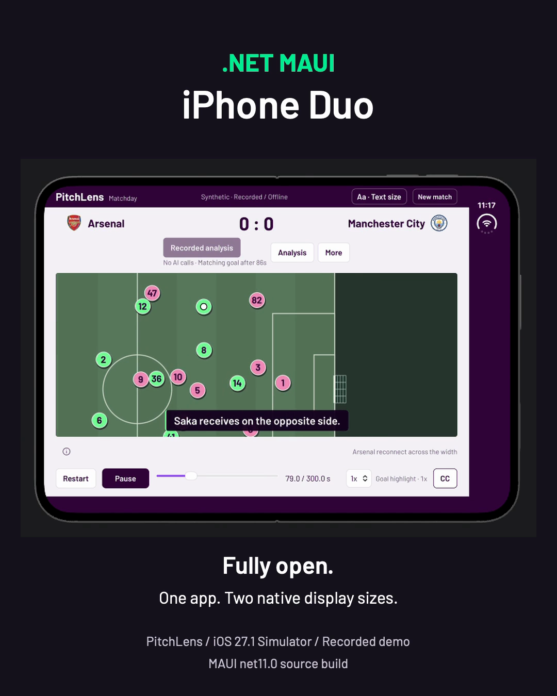
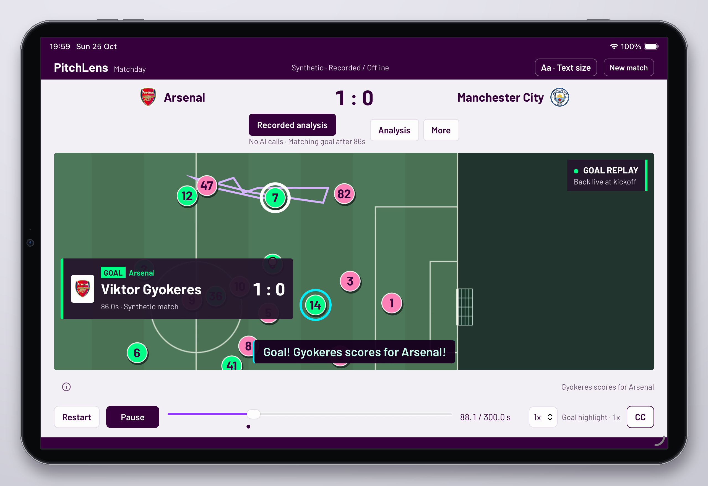
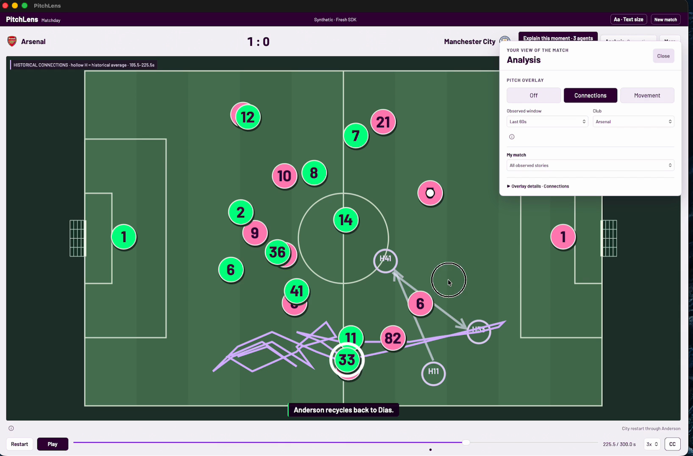
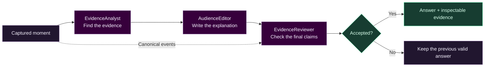
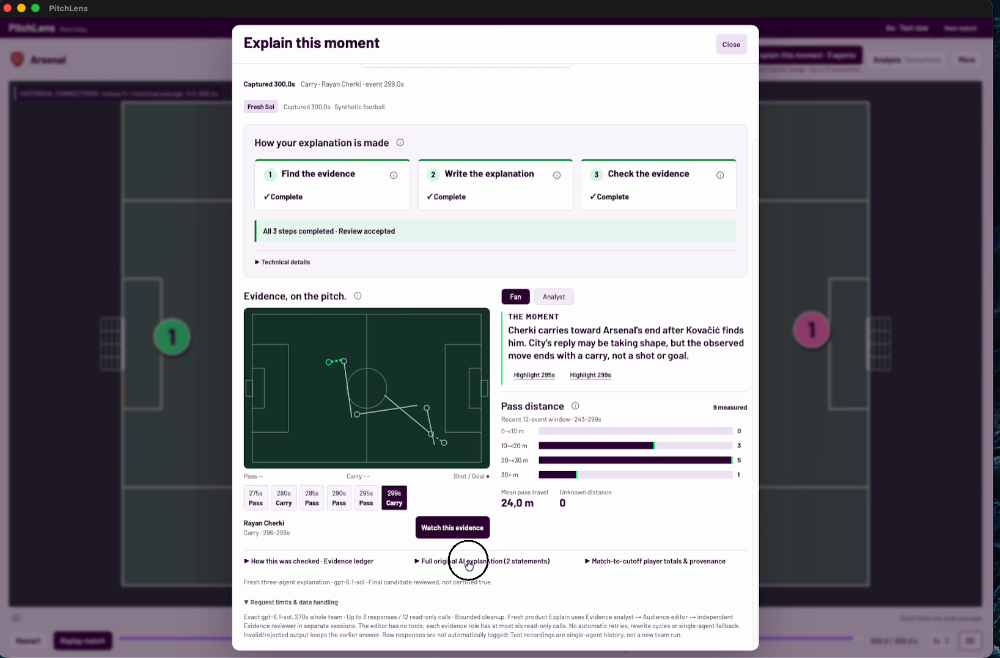

<p align="center">
  
</p>

<p align="center">
  <strong>macOS + iOS preview · Synthetic football · Evidence you can explore</strong>
</p>

<p align="center">
  <a href="#demo">Watch the demo</a> &nbsp; / &nbsp;
  <a href="#three-agents-one-captured-moment">Meet the agents</a> &nbsp; / &nbsp;
  <a href="#try-it-locally">Quick start</a> &nbsp; / &nbsp;
  <a href="#contributing">Contribute</a>
</p>

---

## Football you can explore. Explanations you can inspect.

PitchLens turns a synthetic match into an interactive football playground.
Follow the play, uncover passing connections, explore a player's contribution,
then ask **why this moment matters**. Three specialist agents work from the same
captured evidence, and the answer takes you back to the action.

| Play | Explore | Understand |
|---|---|---|
| A five-minute, 22-player synthetic match. Pause, seek and revisit the story. | Passing networks, movement, player lenses and Match Story, right on the pitch. | Evidence-led explanations with independent review and clickable supporting events. |

**C# / .NET MAUI Blazor Hybrid + GitHub Copilot SDK.** Real club and player
identities; synthetic match actions, not broadcast footage or real performance
analysis.

## Demo

### On iPhone Duo · One app, two native display sizes

<p align="center">
  <a href="https://github.com/kubaflo/pitchlens/releases/download/demo-media-2026-10-25/PitchLens-MAUI-iPhone-Duo-LinkedIn.mp4"></a>
  <a href="https://github.com/kubaflo/pitchlens/releases/download/demo-media-2026-10-25/PitchLens-MAUI-iPhone-Duo-LinkedIn.mp4"></a>
</p>

<p align="center">
  <strong><a href="https://github.com/kubaflo/pitchlens/releases/download/demo-media-2026-10-25/PitchLens-MAUI-iPhone-Duo-LinkedIn.mp4">Watch the final Duo film · 43 seconds · Silent</a></strong><br />
  <a href="https://github.com/kubaflo/pitchlens/pull/5">Experimental Duo source &amp; integration PR</a>
</p>

Experimental .NET MAUI running on the **iPhone Duo / iOS 27.1 simulator**:
fully folded/closed for 0–16s, then fully open for 16–43s. Only those two
states appear—no partially-open footage or folding transitions. The complete
native Device Hub device frame is retained, not an illustrated skin or fake
hinge. Click either preview to download/watch the exact film.

This is a **recorded synthetic match**, not physical hardware or fresh
three-agent inference. Fresh iOS AI still requires an authenticated backend.
The film is silent, with burned-in titles and disclosures; it has no voiceover
or subtitle sidecar. The Mac and narrated iPad films remain below.

<details>
<summary><strong>Duo film: source build, device frame &amp; integration status</strong></summary>

43 seconds, 1080 × 1350, H.264/yuv420p, 30 fps, faststart. The capture is cropped
outside the complete device chassis, then uniformly scaled and padded without
stretching. The native app hosts use a 382 × 644 closed cover and an 867 × 635
fully open single-pane viewport.

The on-screen **MAUI net11.0 source build** disclosure refers to an experimental
framework source branch, **not an app targeting .NET 11 or a shipped/GA package**.
The app targets `net10.0-ios27.1`, using MAUI source `a561eaec` with the changes
from [dotnet/maui#38915](https://github.com/dotnet/maui/pull/38915) and
[dotnet/maui#38911](https://github.com/dotnet/maui/pull/38911), .NET SDK
10.0.402, workload set 10.0.402.1, iOS pack 27.1.10018 and Xcode 27.1 (27A9275).
This is separate from the Mac build instructions below.

The [Duo source in PR #5](https://github.com/kubaflo/pitchlens/pull/5)
is pushed on
[`kubaflo-pitchlens-iphone-duo`](https://github.com/kubaflo/pitchlens/tree/kubaflo-pitchlens-iphone-duo)
at `cecabfa7a14f0cf219b89f33d94f7f1a20763904`, stacked on the separate iOS branch.
Neither is integrated into this showcase branch or `main`. No physical-device,
App Store, shipped-package or fresh-AI certification is claimed.

</details>

### On iPad · Understand the moment

[](https://github.com/kubaflo/pitchlens/releases/download/demo-media-2026-10-25/pitchlens-ipad-framed-promo.mp4)

<p align="center">
  <strong><a href="https://github.com/kubaflo/pitchlens/releases/download/demo-media-2026-10-25/pitchlens-ipad-framed-promo.mp4">Watch the iPad promo · 60 seconds</a></strong><br />
  <a href="https://github.com/kubaflo/pitchlens/releases/download/demo-media-2026-10-25/pitchlens-ipad-framed.en.srt">English subtitles</a>
  &nbsp; / &nbsp;
  <a href="https://github.com/kubaflo/pitchlens/pull/4">iOS source &amp; integration PR</a>
</p>

A recorded match, Fan and Analyst views, player lenses and Match Story.
**Watch this evidence** pins Saka's carry at 82s, before his pass at 84s and
Gyokeres' goal at 86s. This iOS demo makes **no fresh AI requests**; fresh iOS AI
requires an authenticated backend that is not implemented yet. The separate Mac
film below demonstrates the fresh three-agent workflow.

<details>
<summary><strong>iPad film: simulator capture &amp; editorial frame</strong></summary>

Actual production UI captured on a landscape **iPad mini (A17 Pro), iOS 26.5
simulator**, using Debug-only opt-in loopback inspection. This is not a physical
iPad recording. The original illustrated bezel, camera, buttons and shadow are
editorial framing, not an Apple device photograph.

The 60-second H.264 film is 2560 × 1760 at 30 fps. Its 2266 × 1488 app screen is
positioned at 1:1 with no screen scaling or cropping. It shows the historical
synthetic Arsenal–City recording: Saka's carry (`e25`) ends at 82s and Gyokeres'
goal (`e28`) occurs at 86s. Recorded explanations are not fresh three-agent
inference. ElevenLabs George narration and caption timing are unchanged;
narration has not been listening-reviewed.

</details>

### On Mac · Follow the three-agent workflow

[](https://github.com/kubaflo/pitchlens/releases/download/demo-media-2026-10-25/pitchlens-demo-elevenlabs.mp4)

<p align="center">
  <strong><a href="https://github.com/kubaflo/pitchlens/releases/download/demo-media-2026-10-25/pitchlens-demo-elevenlabs.mp4">Watch the film · 82 seconds</a></strong><br />
  <a href="https://github.com/kubaflo/pitchlens/releases/tag/demo-media-2026-10-25">GitHub video &amp; captions</a>
  &nbsp; / &nbsp;
  <a href="https://github.com/kubaflo/pitchlens/releases/download/demo-media-2026-10-25/pitchlens-demo.en.srt">English subtitles</a>
</p>

From the goal celebration to passing connections, player exploration and a
three-agent explanation, the film follows the product all the way back to
**Watch this evidence**.

<details>
<summary><strong>Inside the film: moments, narration &amp; media details</strong></summary>

The film opens with Calafiori's Arsenal goal at match time 204s. Later, the
full-time explanation concerns a **different event**: Cherki's carry ending at
299s (`e61`), following Kovacic's pass. It shows the Fan answer and its evidence,
not a Fan-to-Analyst toggle. Waiting time is shortened in the edit.

The English voiceover is synthetic ElevenLabs George narration added to the
video, **not in-app speech**. Pronunciation has not been listening-reviewed.
The two Mac screenshots on this page are unscaled frames from that same video.
The hero is original illustrative artwork, not an app screenshot.

The exact demo is hosted as a GitHub release asset, not a large binary in source
history. It is 1636 × 1078 at 60 fps, with no crop or resize. The release is
**media-only**, not an app download. While this repository is private, the media
requires repository access; the release page provides an authenticated download.

</details>

> **Publication status:** prepared for an open-source launch, but **not yet
> open source**. No project code license has been selected. Third-party asset
> redistribution and demo-media rights must also be cleared before public
> publication. See [License & asset rights](#license--asset-rights).

## From a match to an inspectable explanation

1. **Choose your match.** Pick two clubs or a random matchup. Create a fresh
   five-minute, 22-player synthetic match, or explore the bundled recording
   without an account.
2. **Read the pitch.** Play, pause and seek; inspect passing connections, movement,
   player lenses and Match Story. Explanations use the captured observed events,
   not future passages of play.
3. **Ask about a moment.** Choose why it matters, the build-up, or a player's
   contribution. Follow the evidence, writing and review stages as they run.
4. **Go back to the evidence.** Inspect cited events and use **Watch this evidence**
   to pin the supporting action on the pitch.

## Three agents, one captured moment

On Mac, fresh **Explain this moment** uses three separate Copilot SDK sessions on
`gpt-6.1-sol`, connected by validated, typed handoffs:



| Agent | Responsibility | Boundary |
|---|---|---|
| **EvidenceAnalyst** | Read captured match/event evidence and produce three cited findings. | At most six read-only calls; at most five unique cited events. |
| **AudienceEditor** | Turn the validated findings into Fan and Analyst explanations. | No tools; may cite only the analyst's cited events. |
| **EvidenceReviewer** | Independently read every cited event and check every final claim. | At most six read-only calls; approval binds to the exact answer hash. |

The coordinator checks evidence IDs, captured-match identity, handoff hashes and
complete review coverage. A rejected or invalid stage stops the request and keeps
the previous valid answer. There is no automatic retry or single-agent fallback.
One fresh explanation uses up to **three responses and twelve evidence reads**
within a shared **270-second** deadline.

**Review accepted is an application acceptance gate, not proof of causal truth
or guaranteed AI accuracy.** Read the cited events and treat interpretations as
tentative.



Underneath the agents, C# owns the validated match and authoritative replay clock.
Razor components render the native Hybrid interface; a JavaScript canvas renders
the pitch. Evidence capture freezes the request's revision, time and focus so
specialists work against the same moment.

## Try it locally

### Supported setup

**This publication branch targets Apple Silicon macOS via Mac Catalyst.**
The separately pushed [iOS implementation (PR #4)](https://github.com/kubaflo/pitchlens/pull/4)
is on [`kubaflo-pitchlens-for-ios`](https://github.com/kubaflo/pitchlens/tree/kubaflo-pitchlens-for-ios),
not yet integrated here or into `main`. Its recorded/offline flow has been checked
on iPhone 11 Pro and iPad mini simulators; physical-device provisioning and App
Store distribution are not verified. Fresh iOS AI remains unavailable pending an
authenticated backend. The experimental iPhone Duo source is separately pushed
in [PR #5](https://github.com/kubaflo/pitchlens/pull/5), stacked on that iOS branch;
its source-build toolchain is described with the Duo film above.
Windows, Linux, Android and Intel Mac app builds are not
verified. The build instructions below are for **this Mac branch**.

| Component | Repository pin / build baseline |
|---|---|
| .NET SDK | `10.0.402` in [`global.json`](global.json), with `latestPatch` roll-forward |
| .NET workload set | `10.0.302` in `global.json` |
| MAUI Controls & Blazor WebView | `10.0.20` |
| GitHub Copilot SDK | `1.0.22` |
| Xcode | Previously verified with `26.6` (`17F113`); not pinned by the repo |
| App target | `net10.0-maccatalyst`, `maccatalyst-arm64`, Catalyst minimum `17.0` |

Use a configured Xcode installation and the matching .NET toolchain. The recorded
development package used macOS 14 as its minimum. It is ad-hoc signed, **not
notarized or verified as an external public installer**.

### Build

Install [.NET SDK 10.0.402](https://dotnet.microsoft.com/download/dotnet/10.0)
and [Xcode](https://developer.apple.com/xcode/) first. Cloning currently requires
an authenticated GitHub account with access to this private repository.
The default `main` branch currently contains only a README; the publication
branch below contains the app and its source history.

```sh
git clone https://github.com/kubaflo/pitchlens.git
cd pitchlens
# Until the publication PR is merged, the full source is on this branch:
git switch kubaflo-pitchlens-github-launch

dotnet --info
dotnet workload --info
xcodebuild -version

# If this workload is missing, install it with the pinned SDK selected:
dotnet workload install maui-maccatalyst

dotnet build src/PitchLens.App -c Debug \
  -p:EnableCodeSigning=true -p:CodesignKey=- -p:CreatePackage=false
```

Restoring requires network access to NuGet and GitHub. The app build downloads
and bundles the SDK's Copilot runtime; it does not launch the app or make a model
request. The development bundle is produced at:

```text
src/PitchLens.App/bin/Debug/net10.0-maccatalyst/maccatalyst-arm64/PitchLens.app
```

Open that development bundle yourself when ready, or explicitly run:

```sh
dotnet build src/PitchLens.App -c Debug -t:Run \
  -p:EnableCodeSigning=true -p:CodesignKey=- -p:CreatePackage=false
```

### No-account exploration vs fresh AI

The following fresh-request behavior applies to **Mac**. The separate iOS branch
supports recorded/offline exploration, not fresh generation or explanation.

| Mode | What you get | Account / usage |
|---|---|---|
| **Recorded demo / Test** | Bundled AI-authored match, matching recorded goal explanation and guided demo. | No Copilot login or model calls at runtime. Building still requires downloads. |
| **Live / fresh requests** | New match generation, the three-agent explanation, and optional Director's Cut edits. | Authenticated Copilot access, the exact model enabled, and available billable/included usage under your plan. |
| **Cached explanation** | An exact previously accepted explanation for the same captured request. | No new model call for the cache hit. |

At startup, choose **Recorded demo · No AI calls** or **Guided demo** for the
account-free path. Test mode blocks SDK requests; its recorded explanation is
historical **single-agent output**, not a simulated three-agent review. The
bundled recording is not the fresh match shown in the Mac video; it is the
historical match used by the iPad promo.

For fresh operations, install the
[GitHub Copilot CLI](https://docs.github.com/en/copilot/how-tos/copilot-cli/install-copilot-cli)
and run `copilot login`
yourself in Terminal with an entitled account. The app checks authentication and
exact `gpt-6.1-sol` availability; it does not silently choose another model.
**Create match** uses Copilot usage: normally two responses, up to three with a
bounded correction, within a fifteen-minute overall budget. Explanation usage is
separate. Never put account tokens or API keys in source files.

## Data, scope & limitations

The six-club pool is **Arsenal, Manchester City, Liverpool, Chelsea, Manchester
United and Tottenham Hotspur**. The roster is a selected 2026/27 prototype
snapshot, not a live squad feed, actual starting XI or official season dataset.
[Fixture provenance](src/PitchLens.Generation/Resources/fixture-provenance.json)
and [portrait provenance](src/PitchLens.Generation/Resources/player-portraits.json)
record the source scope.

Paths, events, scores, captions and narrative describe **synthetic football**.
This is not a real broadcast feed, athlete evaluation, prediction service or
verified tactical analysis. No Azure or Foundry deployment is included.

Fresh model access and latency depend on your Copilot account and model
availability. A successful headless check does not certify native UI behavior,
AI truthfulness or cross-platform support.

## Repository map

| Path | Purpose |
|---|---|
| [`src/PitchLens.App`](src/PitchLens.App) | MAUI Mac Catalyst host, Razor UI, local preferences and canvas renderer |
| [`src/PitchLens.Core`](src/PitchLens.Core) | Replay, match model, story and presentation logic |
| [`src/PitchLens.Generation`](src/PitchLens.Generation) | Copilot adapters, three-agent coordinator, evidence validation and recordings |
| [`tests/PitchLens.Core.Tests`](tests/PitchLens.Core.Tests) | Headless C# tests, including rendered Razor components |
| [`tests/js`](tests/js) | Node tests for the production rendering and interaction modules |
| [`tools`](tools) | Explicit generation/validation and headless performance utilities |
| [`design`](design) | Design explorations and third-party asset provenance |

## Contributing

Until a code license and asset rights are resolved, **do not assume permission
to redistribute this repository or its media**. Once contribution terms are
established, focused issues and pull requests are welcome. Describe the expected
behavior, keep synthetic/recorded/fresh labels truthful, and keep evidence
boundaries and usage notices intact.

Run the checks relevant to your change:

```sh
dotnet test tests/PitchLens.Core.Tests -c Release
node --test tests/js/*.test.mjs
```

The core test project is headless and does not require launching the app or
XCTest. Visual/native changes still need separate user-operated acceptance.
Live generation tools can consume account usage; do not run them as an implicit
test step. Report suspected credential exposure privately to the repository
owner rather than posting values in an issue.

## License & asset rights

**No project code license has been selected or granted yet.** A public repository
alone would not make this project open source. The owner must choose and approve
a license before that claim or public launch.

Club crests, player portraits and the Premier League mark retain their
rightsholders' rights. Existing provenance records describe user-reported
**non-commercial/prototype permission**, not public redistribution clearance or
an open-asset license. This also matters for the app icon/splash, historical
design files, screenshots and video. Clear those rights or replace the assets
before exposing repository history or media publicly. PitchLens is independent
and unaffiliated with the league or clubs.

Barlow is bundled under the
[SIL Open Font License](src/PitchLens.App/wwwroot/fonts/OFL.txt).
Dependencies and the bundled Copilot runtime retain their upstream licenses.
No future project code license should be read as a license to third-party
imagery or as endorsement by a club, league, GitHub or ElevenLabs.
